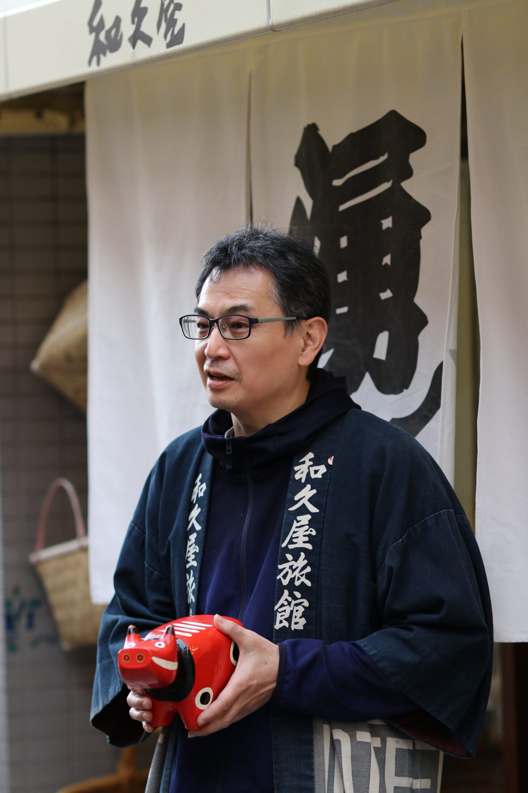

阿武隈川がながれる東北の都・郡山。

音楽がさかんなことで知られるこの街、郡山駅前の繁華街・中町の中心部に位置する、由緒ある安積国造神社（あさかくにつこ）神社に続く表参道に店をかまえています。屋号の歴史は江戸時代から、昭和の時代からはじまったおみやげ屋は、地域の人たちに親しまれ、今では家業となりました。店の目の前には昔を偲ばせる石造りの鳥居が建っています。「湧」の字の暖簾をくぐり、なつかしいあのときに戻って、ひとときをお楽しみください。

